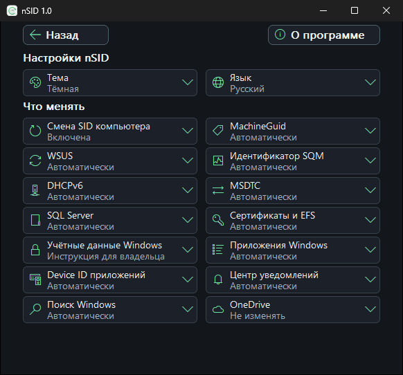

# nSID для Windows 11 x64

[English](README.en.md) · [Загрузки](https://github.com/nr084/nsid-releases/releases) · [Лицензия](LICENSE.ru.md)

> [!WARNING]
> **Смена SID и других системных идентификаторов может привести к потере данных и сделать Windows незагружаемой.** После операции можно потерять доступ к учётным записям, профилям, зашифрованным файлам и сохранённым учётным данным. Приложения и удалённый вход могут перестать работать. Перед запуском сделайте полную резервную копию, проверьте восстановление и сначала испытайте операцию на отдельном клоне.
>
> **nSID поставляется «как есть» (AS IS), без гарантий** в пределах, допускаемых применимым законом. Правообладатель не отвечает за ущерб, связанный с использованием программы, в той мере, в какой это допускает закон. Обязательные права пользователя сохраняются. Подробности приведены в [лицензии](LICENSE.ru.md).

nSID — бесплатная утилита с закрытым исходным кодом для работы с идентификаторами компьютера в Windows. Графическая версия показывает текущий SID компьютера и настройки подсистем. Консольная версия читает SID и сохраняет диагностические отчёты.

**Статус версии 1.0.** Итоговые испытания опубликованного архива на Windows 11 x64 ещё предстоят. Пока используйте сборку только на тестовых клонах.

Выпуски для Windows 10 22H2 x86 и Windows 11 ARM64 не проходили проверку запуска и миграции. Используйте их только на тестовых клонах.

nSID разрабатывается для миграции клонов Windows в рабочей группе. Перечень проверенных операций и ограничения конкретной версии приводятся на странице релиза.

Перед миграцией полностью расшифруйте системный том и затрагиваемые тома данных. Приостановки BitLocker недостаточно.

Храните полный образ вне компьютера и заранее проверьте его восстановление на клоне. Если Windows перестанет загружаться после миграции, используйте WinRE или загрузочный носитель вашего средства резервного копирования, чтобы вернуть образ, созданный до запуска nSID. Порядок восстановления описан в инструкции внутри архива. [Среда восстановления Windows](https://support.microsoft.com/en-us/windows/experience/backup-recovery/windows-recovery-environment)

### Сохранённые учётные данные Windows

Если вам нужны записи Диспетчера учётных данных, выполните эти действия отдельно под владельцем каждого затронутого профиля. Сначала проверьте восстановление на отдельном клоне.

1. До смены SID откройте через поиск Windows «Диспетчер учётных данных». Выберите «Учётные данные Windows» → «Архивация учётных данных». Сохраните файл `.crd` в защищённом месте и задайте пароль архива в мастере Windows.
2. После перезагрузки войдите в тот же профиль. Если нужные записи недоступны, откройте «Восстановление учётных данных», выберите архив этого профиля и введите пароль архива. Мастер может заменить учётные данные, добавленные или изменённые после архивации.
3. Проверьте доступ в приложении или к сетевому ресурсу, которому нужна запись.

Мастер может попросить нажать Ctrl+Alt+Delete для перехода на защищённый рабочий стол Windows. Архив охватывает поддерживаемые мастером записи Windows. Входы на сайты восстанавливаются средствами браузера.

Сохраните копию вне компьютера, который предстоит изменить. Если профиль принадлежит отключённой учётной записи, согласуйте проверку защищённых данных с владельцем до миграции. Пока владелец не может войти в свой сеанс, итог проверки этого профиля остаётся открытым.

Защищённые ассоциации файлов и протоколов остаются под управлением Windows. Если после миграции Windows предложит выбрать приложение или откроет файл в другой программе, восстановите нужное назначение в разделе «Параметры → Приложения → Приложения по умолчанию».

Миграция предусматривает завершение пользовательских сеансов и перезапуск Windows. Сохраните работу во всех сеансах перед запуском. Если вы работаете через RDP, для завершения сеанса выберите «Выйти» в Windows. Закрытие окна RDP оставляет сеанс открытым. После перезапуска проверьте итоговый отчёт, прежде чем возвращать компьютер в эксплуатацию. В браузере может потребоваться повторный вход на сайты.

Интерфейс доступен на русском и английском. В меню настроек можно выбрать светлую или тёмную тему либо использовать тему Windows. Инструкции для CLI и лицензия на обоих языках входят в архив.

© nr084

## Интерфейс nSID 1.0

