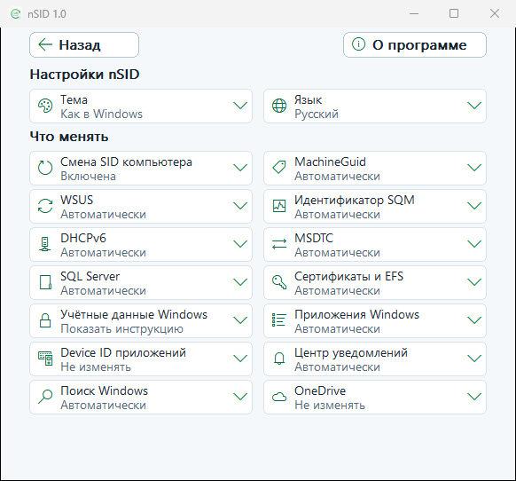
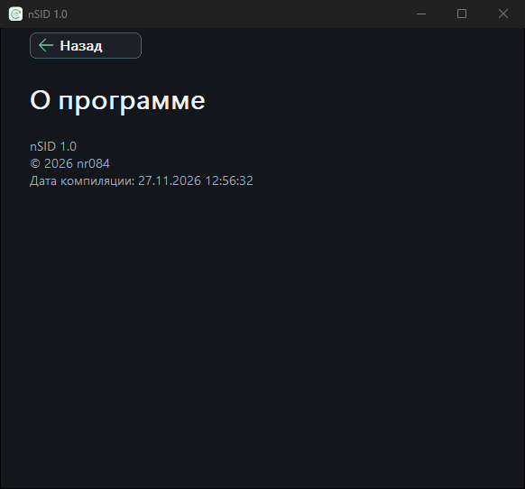

# nSID for Windows

[Русский](README.ru.md) · [Downloads](https://github.com/nr084/nsid-releases/releases) · [License](LICENSE.en.md)

> [!WARNING]
> **Changing the machine SID and other system identifiers can cause data loss and leave Windows unable to boot.** You may lose access to accounts, profiles, encrypted files, and stored credentials. Applications and remote sign-in may stop working. Before running the operation, make a full backup, verify that you can restore it, and test on a separate clone first.
>
> **nSID is provided AS IS, without warranties** to the extent permitted by applicable law. The copyright holder is not liable for damage arising from use of the software to the extent permitted by law. Mandatory user rights remain in effect. See the [license](LICENSE.en.md) for details.

nSID is a free, closed-source Windows utility for working with computer identifiers. The graphical version displays the current machine SID and subsystem settings. The command-line version reads the SID and writes diagnostic reports.

## Tested systems in nSID 1.1

| System | Architecture | GUI and CLI |
| --- | --- | --- |
| Windows 10 Pro 22H2 | x86, x64 | Tested in QEMU clones |
| Windows Server 2022 and 2025 Standard with Desktop Experience | x64 | Tested in QEMU clones |
| Windows 11 | x64 | Unchanged scenarios use the 1.0 acceptance results |
| Windows 11 | ARM64 | Build available, VM testing pending |

The eight Windows 10 and Windows Server runs verified a new machine SID,
a normal restart, a fresh WinRM sign-in, and access to the original profiles
for both an administrator and a standard user. DPAPI, EFS, and certificate
private-key use passed with test data. OneDrive and Device ID checks used
synthetic entries. This coverage excludes cloud sync, live OneDrive accounts,
and application-specific behavior.

nSID is being developed for migrating Windows clones in workgroups. See the release page for the operations verified for each version and any limitations.

Before migration, fully decrypt the system volume and affected data volumes. Suspending BitLocker is insufficient.

Keep a full image off the computer and verify that it restores on a clone. If Windows fails to boot after migration, use WinRE or your backup provider's bootable media to restore the image created before running nSID. The archive includes recovery instructions. [Windows Recovery Environment](https://support.microsoft.com/en-us/windows/experience/backup-recovery/windows-recovery-environment)

### Saved Windows credentials

Changing the SID can make Credential Manager entries unavailable even when the profile and DPAPI-protected data survive. If you rely on Credential Manager entries, follow these steps separately as the owner of each affected profile. Verify restoration on a separate clone first.

1. Before changing the SID, search Windows for Credential Manager. Select Windows Credentials → Back up Credentials. Save the `.crd` file in a protected location and set an archive password in the Windows wizard.
2. After restarting, sign in to the same profile. If you need to recover missing entries, choose Restore Credentials, select that profile's archive, and enter its password. The wizard may replace credentials added or changed after the backup.
3. Verify access in the application or network resource that uses the saved credential.

The wizard may ask you to press Ctrl+Alt+Delete to switch to the Windows secure desktop. The archive covers Windows entries supported by the wizard. Website sign-ins are handled by your browser.

Keep a copy off the computer being migrated. If a profile belongs to a disabled account, coordinate protected-data checks with its owner before migration. Verification for that profile remains pending until the owner can sign in.

Windows manages protected file and protocol associations. If Windows asks you to choose an app after migration or opens a file in a different app, set your preferred app under Settings → Apps → Default apps.

Migration involves signing users out and restarting Windows. Save work in all sessions before starting. If you use RDP, choose Sign out in Windows to end the session. Closing the RDP window leaves it open. After the restart, review the result report before returning the computer to service. You may need to sign in to websites again.

The interface is available in Russian and English. In Settings, choose the light theme, the dark theme, or the Windows default. The archive includes command-line instructions and license terms in both languages.

© nr084

## Interface

Screenshots show the Russian interface in 1.0.

